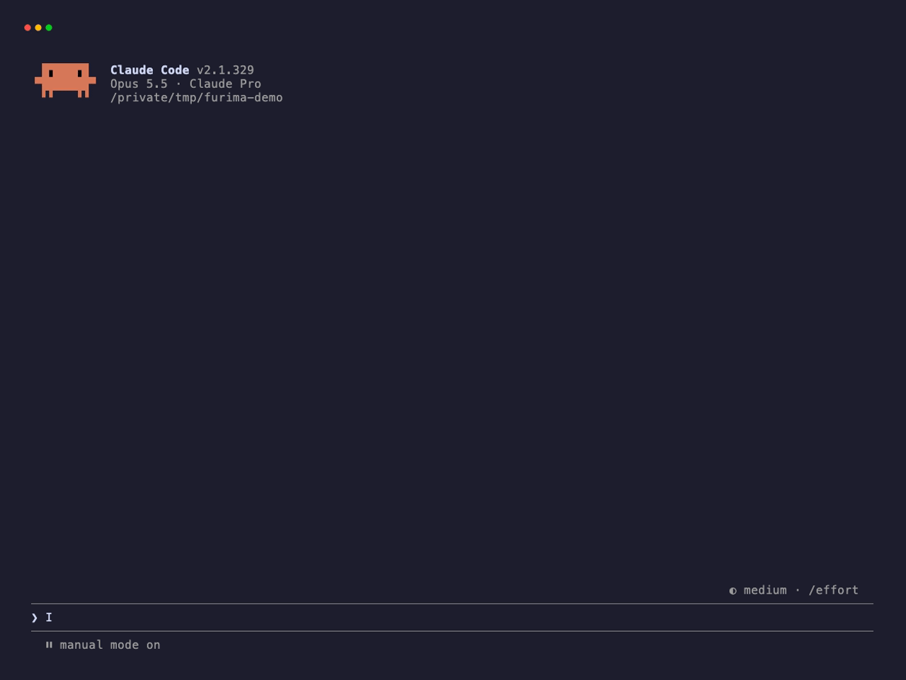
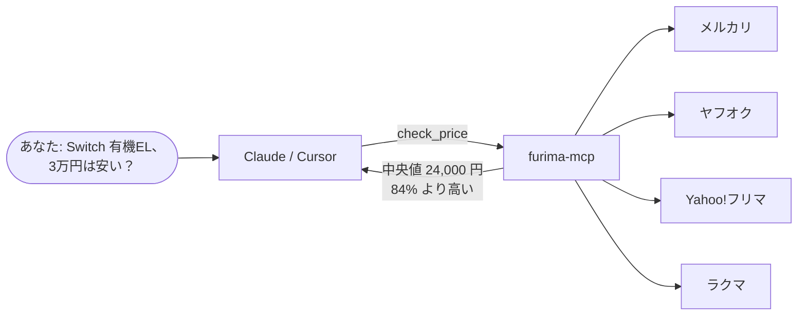

<div align="center">


# furima-mcp

**「これ、実際いくらで売れてる？」を AI に聞ける。**

メルカリ · ヤフオク · Yahoo!フリマ · ラクマ

[](https://github.com/fxia0018/furima-mcp/actions/workflows/ci.yml)
[](https://pypi.org/project/furima-mcp/)
[](https://pypi.org/project/furima-mcp/)
[](LICENSE)

[English](README.md) | 日本語

</div>



furima-mcp は [MCP](https://modelcontextprotocol.io) サーバーです。Claude や Cursor などの AI アプリに機能を追加する小さなプラグインのようなもので、これを入れると、国内の 4 大フリマ・オークションサイトをまとめて検索し、**実際に売れた価格**から相場を判断できるようになります。

<table>
<tr>
<td width="50%" valign="top">

### 4 サイトを一度に
メルカリ・ヤフオク・Yahoo!フリマ・ラクマを数秒でまとめて検索。1 サイトが落ちていても他の結果は返ります。

</td>
<td width="50%" valign="top">

### 売れた価格で相場
出品価格ではなく、直近の売却価格から中央値・四分位・範囲を計算。「3 万円は安い？」にパーセンタイルで答えます。

</td>
</tr>
<tr>
<td valign="top">

### 状態別に比べる
新品・未使用に近い・傷あり…。全サイト共通の 6 段階で相場を分けるので、未開封品と使用感のある品を混ぜずに比べられます。

</td>
<td valign="top">

### 新着をウォッチ
「安いのが出たら教えて」。チェックするたびに、前回以降の新しい出品だけを返します。

</td>
</tr>
</table>

アカウント・API キー・ブラウザは不要。読み取り専用で、各サイトに負荷をかけないよう間隔をあけてアクセスします。

## しくみ



| サイト | 出品中 | 売却価格 | 商品の状態 |
| --- | --- | --- | --- |
| メルカリ | 対応 | 対応 | 対応 |
| ヤフオク | 対応 | 対応（落札価格） | 対応 |
| Yahoo!フリマ | 対応 | 対応（ヤフオク経由） | 対応 |
| ラクマ | 対応 | 対応 | 状態で絞り込んだときのみ |

## はじめかた

**1. uv をインストール**します。Python のツールを準備なしで動かせるツールです。入っていれば不要です。

```sh
# macOS / Linux
curl -LsSf https://astral.sh/uv/install.sh | sh

# Windows（PowerShell）
powershell -ExecutionPolicy ByPass -c "irm https://astral.sh/uv/install.ps1 | iex"
```

**2. AI アプリに追加**します。使っているものを選んでください。

<details open>
<summary><b>Claude Desktop</b></summary>

**設定（Settings）→ 開発者（Developer）→ Edit Config** を開くと `claude_desktop_config.json` が開きます。次の内容を貼り付け（すでに `mcpServers` があればその中に追加）、保存して Claude Desktop を再起動します。

```json
{
  "mcpServers": {
    "furima": {
      "command": "uvx",
      "args": ["furima-mcp"]
    }
  }
}
```

</details>

<details>
<summary><b>Claude Code</b></summary>

```sh
claude mcp add furima -- uvx furima-mcp
```

</details>

<details>
<summary><b>Cursor などその他の MCP アプリ</b></summary>

Claude Desktop と同じ JSON を、各アプリの MCP 設定（Cursor なら `.cursor/mcp.json`）に書きます。

</details>

<details>
<summary><b>Docker</b>（Python・uv 不要）</summary>

```sh
docker build -t furima-mcp https://github.com/fxia0018/furima-mcp.git
```

上の JSON で `"command": "docker", "args": ["run", "-i", "--rm", "furima-mcp"]` を使います。

</details>

**3. 聞いてみる。** たとえば:

- 「ドラクエ3 SFC 箱説付き」の相場を調べて
- Switch 有機ELモデル、3 万円は安い？
- Switch 有機ELモデル、新品未開封と中古で相場はどれくらい違う？
- 「ピカチュウ 25th プロモ」を 5,000 円以下で安い順に。PSA 鑑定品は除いて
- α7 III ボディの 12 万円以下の新着をウォッチして、聞くたびに新しい出品を教えて
- この商品はお得？ https://jp.mercari.com/item/m12345678901

商品名や型番（`CFI-2000`、`ILCE-7M3` など）で検索すると精度が上がります。

## よくある質問

<details>
<summary><b>Claude Desktop でサーバーが起動しない・「spawn uvx ENOENT」と出る</b></summary>

macOS のデスクトップアプリは、ターミナルと同じフォルダを見られないことがあり、`uvx` が見つかりません。ターミナルで `which uvx`（Windows は `where uvx`）を実行し、表示されたフルパス（例: `"/Users/you/.local/bin/uvx"`）を `"command"` に書いて、Claude Desktop を再起動してください。

</details>

<details>
<summary><b>アカウント・API キー・料金は必要？</b></summary>

不要です。furima-mcp は無料で、ブラウザで誰でも見られる公開ページを読むだけです。AI アプリ側のプランや利用制限はそのまま適用されます。

</details>

<details>
<summary><b>勝手に購入したり、出品者にメッセージを送ったりしない？</b></summary>

しません。すべてのツールは読み取り専用で、ログインもしないため、どのアカウントも操作できません。

</details>

<details>
<summary><b>付属品・空箱・ジャンクが混ざる</b></summary>

各サイトのキーワード検索はあいまいです。型番などで具体的に検索し、「ジャンク」「箱のみ」などを除外するよう AI に頼み、状態でも絞り込んでください。相場系のツールは、検索語をすべて含むタイトルだけを最初から使っています。

</details>

<details>
<summary><b>価格はどれくらい正確？</b></summary>

価格は各サイトの数値そのままです。ずれる原因は「どの商品がヒットするか」です（上を参照）。メルカリ・ラクマは送料込みが多く、ヤフオクは送料別が多いため、ヤフオクはやや安く見えることがあります。購入前に必ず商品ページを確認してください。

</details>

## ツール

AI が裏で呼び出すものです。自分で呼ぶ必要はありません。

| ツール | 内容 |
| --- | --- |
| `search_listings` | 出品中の商品を検索。サイト・価格・状態で絞り込み、関連度・新着・価格順（全サイト横断）で並べ替え。 |
| `new_listings` | 前回のチェック以降に出品された商品を新しい順に。初回はカーソルなしで呼び、返ってきたカーソルを次回に渡します。 |
| `sold_price_stats` | 直近の売却価格の最安値・25%・中央値・75%・最高値。全体・サイト別・状態別、実例付き。 |
| `check_price` | ある価格が、同じ状態の直近の売却価格の中でどの位置か（パーセンタイル）と一言の判定。 |
| `get_listing` | 商品 URL の詳細：説明文・状態・画像・出品者の評価・オークション終了時刻。 |

<details>
<summary><b>パラメーターと細かい仕様</b></summary>

- **`conditions`**（検索系ツールすべて）：4 サイト共通の 6 段階。`new`（新品、未使用）、`like_new`（未使用に近い）、`good`（目立った傷や汚れなし）、`fair`（やや傷や汚れあり）、`poor`（傷や汚れあり）、`bad`（全体的に状態が悪い）。
- **`exclude`**：タイトルに指定した語を含む商品を除外します（例: `["ジャンク", "箱のみ"]`）。
- **`match_all_words`**（相場系ツールは初期値オン）：検索語をすべて含むタイトルだけを使います。メルカリで `PS5 CFI-2000` を検索すると PS5 のソフトも混ざり、中央値がソフトの値段まで下がってしまうためです。
- **売却履歴**：ヤフオクの落札済み・ラクマの売り切れ（新しい順）、メルカリの売り切れ（関連度順）から取ります。Yahoo!フリマには独自の売却履歴検索がないため、売れた商品はヤフオクの落札検索経由で `paypay` として返ります。各サイトで読むのは直近の売却 `sample` 件までです。
- **状態**：ラクマの検索結果には状態が表示されないため、`conditions` を指定したときだけラクマの商品に状態が付きます（状態ごとに検索します）。
- **オークション価格**（`is_auction: true`）は現在の入札額で、`ends_at` まで上がる可能性があります。
- **新着ウォッチ**：1 回のチェックで各サイトの新着 40 件を読みます。その間にそれ以上出品された場合は `may_have_missed` にサイト名が入るので、間隔を短くしてください。再出品や値下げは新着として扱いません。
- **メルカリの `sold_at`** は最終更新時刻で、通常は売れた時刻です。**メルカリShops** の商品は検索には出ますが、`get_listing` はまだ対応していません。

</details>

<details>
<summary><b>設定</b></summary>

環境変数（すべて任意）:

| 環境変数 | 初期値 | 意味 |
| --- | --- | --- |
| `FURIMA_MIN_INTERVAL` | `1.0` | 同じサイトへのリクエスト間隔（秒）。下げることは推奨しません。 |
| `FURIMA_CACHE_TTL` | `300` | 同じ検索結果を再利用する秒数。`0` でキャッシュ無効。 |

同じサイトへのリクエストは `FURIMA_MIN_INTERVAL` 以上の間隔をあけ、`429`/`503` は待ってから再試行し、同じ検索はキャッシュから返します。

</details>

## 利用上の注意

ブラウザで誰でも見られる公開ページを、依頼した人の代わりに 1 回ずつ読むツールです。個人の買い物や相場調べを想定しています。大量の自動収集、他人の出品データのデータベース化、自動購入・転売目的には使わないでください。

## 免責事項

本プロジェクトは非公式の個人プロジェクトであり、株式会社メルカリ、LINEヤフー株式会社、楽天グループ株式会社、その他の各サービスとは一切関係がなく、承認・後援も受けていません。商品名・商標・出品内容はそれぞれの権利者に帰属します。

各サイトの仕様変更などにより、結果が不完全・遅延・誤っている場合があります。価格や判定は参考情報であり、購入の助言ではありません。購入前に必ず商品ページをご確認ください。各サイトの利用規約および適用される法令の遵守は利用者の責任です。本ソフトウェアは現状のまま提供され、いかなる保証もありません（[LICENSE](LICENSE) 参照）。

## ライセンス

MIT
