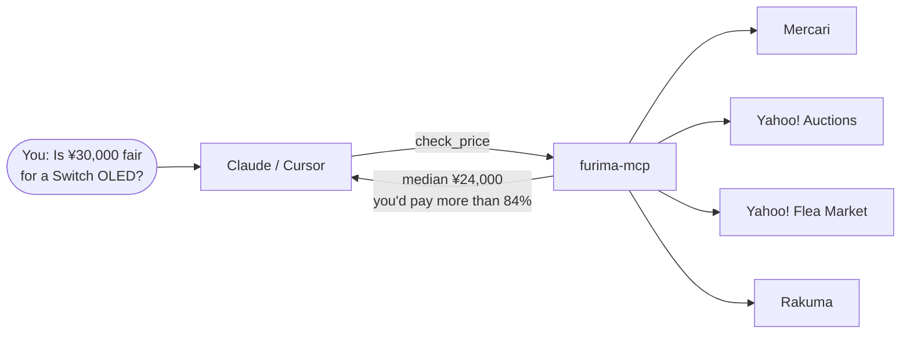

<div align="center">


# furima-mcp

**Ask your AI assistant what something really sells for in Japan.**

Mercari · Yahoo! Auctions · Yahoo! Flea Market · Rakuma

[](https://github.com/fxia0018/furima-mcp/actions/workflows/ci.yml)
[](https://pypi.org/project/furima-mcp/)
[](https://pypi.org/project/furima-mcp/)
[](LICENSE)

English | [日本語](README.ja.md)

</div>

<!-- mcp-name: io.github.fxia0018/furima-mcp -->


furima-mcp is an [MCP](https://modelcontextprotocol.io) server: a small plug-in that gives Claude, Cursor and other AI apps a new skill. This one lets them search Japan's four big second-hand marketplaces at once and work out fair prices from what items **actually sold for**.

<table>
<tr>
<td width="50%" valign="top">

### Four sites, one question
Mercari, Yahoo! Auctions, Yahoo! Flea Market and Rakuma searched together in a few seconds. One site being down doesn't stop the others.

</td>
<td width="50%" valign="top">

### Real sold prices
Median, quartiles and range from recent sales, not asking prices. Ask "is ¥30,000 fair?" and get where that price falls.

</td>
</tr>
<tr>
<td valign="top">

### Compare by condition
New, like new, scratched... Prices are split by the six-step condition scale every site uses, so a sealed unit isn't compared with a worn one.

</td>
<td valign="top">

### Watch for new listings
"Tell me when a cheap one shows up." Each check returns only what went up since the last one.

</td>
</tr>
</table>

No account, no API key, no browser. Read-only and polite to the sites.

## How it works



| Site | For sale now | Sold prices | Item condition |
| --- | --- | --- | --- |
| Mercari | yes | yes | yes |
| Yahoo! Auctions | yes | yes (final bids) | yes |
| Yahoo! Flea Market | yes | yes (through Yahoo! Auctions) | yes |
| Rakuma | yes | yes | only when you filter by it |

## Quick start

**1. Install uv**, which runs Python tools without any setup. Skip this if you have it.

```sh
# macOS / Linux
curl -LsSf https://astral.sh/uv/install.sh | sh

# Windows (PowerShell)
powershell -ExecutionPolicy ByPass -c "irm https://astral.sh/uv/install.ps1 | iex"
```

**2. Add furima-mcp to your AI app.** Pick yours:

<details open>
<summary><b>Claude Desktop</b></summary>

Open **Settings → Developer → Edit Config**. That opens `claude_desktop_config.json`. Paste this in (merge it if the file already has `mcpServers`), save, and restart Claude Desktop:

```json
{
  "mcpServers": {
    "furima": {
      "command": "uvx",
      "args": ["furima-mcp"]
    }
  }
}
```

</details>

<details>
<summary><b>Claude Code</b></summary>

```sh
claude mcp add furima -- uvx furima-mcp
```

</details>

<details>
<summary><b>Cursor and other MCP apps</b></summary>

Use the same JSON as Claude Desktop in the app's MCP config, e.g. `.cursor/mcp.json` for Cursor.

</details>

<details>
<summary><b>Docker</b> (no Python or uv needed)</summary>

```sh
docker build -t furima-mcp https://github.com/fxia0018/furima-mcp.git
```

Then use `"command": "docker", "args": ["run", "-i", "--rm", "furima-mcp"]` in the JSON above.

</details>

**3. Ask.** For example:

- 「ドラクエ3 SFC 箱説付き」の相場を調べて
- Is ¥30,000 a good price for a used Switch OLED?
- What does a sealed Switch OLED sell for compared with a used one?
- Find 「ピカチュウ 25th プロモ」 under ¥5,000, cheapest first, no PSA-graded ones
- Watch for Sony α7 III bodies under ¥120,000 and tell me what's new each time I ask
- Is this a good deal? https://jp.mercari.com/item/m12345678901

Search in Japanese. Product names and model numbers (`CFI-2000`, `ILCE-7M3`) match far better than English descriptions.

## FAQ

<details>
<summary><b>Claude Desktop says the server failed or "spawn uvx ENOENT"</b></summary>

Desktop apps on macOS don't always see the folders your terminal uses, so they can't find `uvx`. Run `which uvx` in a terminal (on Windows: `where uvx`) and put the full path it prints in `"command"`, e.g. `"/Users/you/.local/bin/uvx"`. Restart Claude Desktop.

</details>

<details>
<summary><b>Do I need an account, an API key or to pay anything?</b></summary>

No. furima-mcp is free and reads the same public pages anyone can open in a browser. Your AI app's own plan and limits still apply.

</details>

<details>
<summary><b>Can it buy things or message sellers?</b></summary>

No. Every tool is read-only. It never logs in, so it can't act on any account.

</details>

<details>
<summary><b>Results include accessories, empty boxes or junk</b></summary>

Keyword search on these sites is fuzzy. Be specific (model numbers help most), ask the assistant to exclude words like ジャンク or 箱のみ, and filter by condition. The price tools already keep only titles that contain every word you searched.

</details>

<details>
<summary><b>How accurate are the prices?</b></summary>

The prices are the sites' own numbers. What can be off is *which* listings match, see above. Mercari and Rakuma prices usually include shipping; Yahoo! Auctions prices often don't, so they can look a little cheaper. Always open the listing before you buy.

</details>

## Tools

What the assistant calls behind the scenes. You don't need to call these yourself.

| Tool | What it does |
| --- | --- |
| `search_listings` | Search items for sale now. Filter by site, price and condition; sort by relevance, newest or price across all sites. |
| `new_listings` | Listings put up since the last check, newest first. Call without a cursor to start, then pass back the cursor it returns. |
| `sold_price_stats` | Min / p25 / median / p75 / max of recent sold prices, overall, per site and per condition, with example sales. |
| `check_price` | Where a price falls among recent sales of the same condition (percentile) and a one-line verdict. |
| `get_listing` | Full details of one listing URL: description, condition, images, seller rating, auction end time. |

<details>
<summary><b>Parameters and fine print</b></summary>

- **`conditions`** (every search tool) uses the six-step scale all four sites share: `new` (新品、未使用), `like_new` (未使用に近い), `good` (目立った傷や汚れなし), `fair` (やや傷や汚れあり), `poor` (傷や汚れあり), `bad` (全体的に状態が悪い).
- **`exclude`** drops titles containing any of the given words, e.g. `["ジャンク", "箱のみ"]`.
- **`match_all_words`** (on by default for the price tools) keeps only titles containing every search word. On Mercari, `PS5 CFI-2000` also returns PS5 games, which would drag the median down to a game's price.
- **Sold history** comes from Yahoo! Auctions' closed auctions and Rakuma's sold items (most recent first) and Mercari's sold items (best match first). Yahoo! Flea Market has no sold search of its own; its sold items come through the Yahoo! Auctions closed search, labelled `paypay`. Each site reads up to `sample` recent sales, not the full history.
- **Condition** comes from each listing. Rakuma's search results don't show it, so Rakuma listings carry a condition only when you filter by one (Rakuma is then searched once per condition).
- **Auction prices** (`is_auction: true`) are current bids and may still rise until `ends_at`.
- **Watching.** `new_listings` reads the newest 40 listings per site on each check. If more than that went up in between, `may_have_missed` names the site; check more often. It only reports newly listed items, not old ones relisted or price-dropped.
- **Mercari's `sold_at`** is the item's last update time, which is normally the sale. **Mercari Shops** products show up in search, but `get_listing` doesn't support them yet.

</details>

<details>
<summary><b>Configuration</b></summary>

Environment variables, all optional:

| Variable | Default | Meaning |
| --- | --- | --- |
| `FURIMA_MIN_INTERVAL` | `1.0` | Minimum seconds between two requests to the same site. Raising it is fine; lowering it is not recommended. |
| `FURIMA_CACHE_TTL` | `300` | Seconds a site's search result is reused for an identical query. `0` disables the cache. |

Requests to each site are spaced at least `FURIMA_MIN_INTERVAL` apart, `429`/`503` responses are retried with backoff, and identical searches are served from the cache.

</details>

## Responsible use

This tool reads the same public pages a person sees in a browser, one search at a time, on behalf of the person asking. It is meant for personal shopping and price research.

Please don't use it for bulk scraping, for building a database of other people's listings, or for automated buying or reselling. It carries no account, cookie or personal data, and adding any is out of scope. If a site's operator asks for something to change, open an issue and it will be handled.

## Disclaimer

furima-mcp is an independent, unofficial project. It is not affiliated with, endorsed by or sponsored by Mercari, Inc., LY Corporation, Rakuten Group, Inc. or any marketplace it reads. All product names, trademarks and listing content belong to their respective owners.

The sites can change or restrict access at any time, and results may be incomplete, delayed or wrong. Prices and verdicts are informational, not financial or purchasing advice; check the listing itself before you buy. You are responsible for complying with each site's terms of service and the laws that apply to you. The software is provided as is, without warranty of any kind; see [LICENSE](LICENSE).

## Development

```sh
git clone https://github.com/fxia0018/furima-mcp && cd furima-mcp
uv sync
uv run pytest            # offline tests against hand-written page fixtures
uv run pytest -m live    # one smoke test against the real sites
```

Each site is one module in `src/furima_mcp/sites/` with a `search(client, query)` and an `item(client, url)`. Adding a site means adding a module there and registering it in `sites/__init__.py`. Bug reports and site requests are welcome in [Issues](https://github.com/fxia0018/furima-mcp/issues).

## License

MIT
