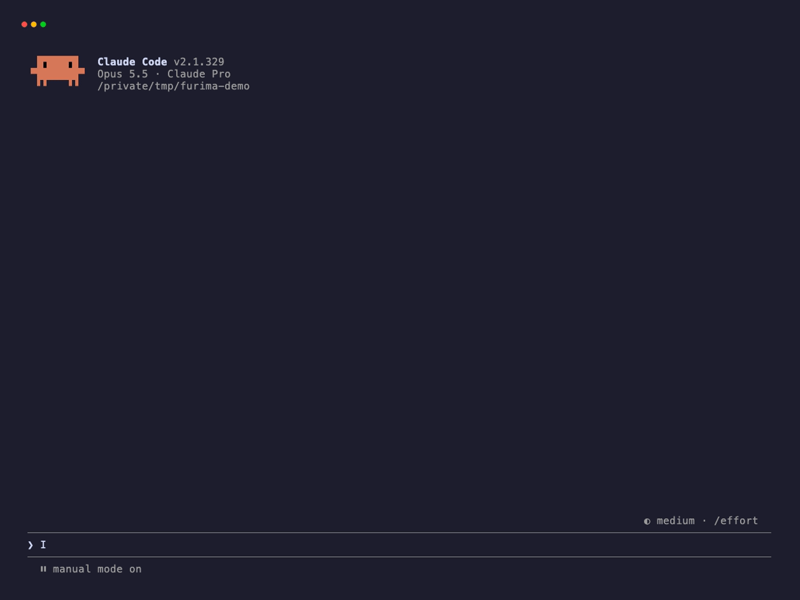

# furima-mcp

[](https://github.com/fxia0018/furima-mcp/actions/workflows/ci.yml)
[](https://pypi.org/project/furima-mcp/)
[](LICENSE)

English | [日本語](README.ja.md)

<!-- mcp-name: io.github.fxia0018/furima-mcp -->

An MCP server for Japanese second-hand marketplaces. It lets Claude, Cursor or any MCP client search **Mercari**, **Yahoo! Auctions**, **Yahoo! Flea Market** (PayPay Flea Market) and **Rakuma** at once, and check what an item actually sells for.



- No browser, no login, no API key. Plain HTTP; a search across all four sites takes a few seconds.
- Prices come from **sold** listings, not asking prices: Yahoo! Auctions final bids, Mercari and Rakuma sold items.
- Compare like with like: filter by item condition (new, like new, good, ...) and see sold prices broken down by condition.
- Watch a search for new listings. The server stores nothing; a small cursor carries the state between checks.
- One site failing doesn't fail the call. Its error is reported next to the other sites' results.
- Polite by default: requests to each site are spaced at least 1 s apart, `429`/`503` responses are retried with backoff, and repeated searches are served from a 5-minute cache.

## Tools

| Tool | What it does |
| --- | --- |
| `search_listings` | Search items for sale now. Filter by site, price and condition; sort by relevance, newest or price across all sites. |
| `new_listings` | Listings put up since the last check, newest first. Call without a cursor to start, then pass back the cursor it returns. |
| `sold_price_stats` | Min / p25 / median / p75 / max of recent sold prices, overall, per site and per condition, with example sales. |
| `check_price` | Where a price falls among recent sales of the same condition (percentile) and a one-line verdict. |
| `get_listing` | Full details of one listing URL: description, condition, images, seller rating, auction end time. |

Every search tool takes `conditions`, on the six-step scale all four sites use: `new` (新品、未使用), `like_new` (未使用に近い), `good` (目立った傷や汚れなし), `fair` (やや傷や汚れあり), `poor` (傷や汚れあり), `bad` (全体的に状態が悪い). They also take `exclude` (drop titles containing these words, e.g. `["ジャンク", "箱のみ"]`). The price tools also take `match_all_words` (on by default) because the sites' own search is fuzzy: on Mercari, `PS5 CFI-2000` also returns PS5 games, which would drag the median down to a game's price.

## Install

Needs [uv](https://docs.astral.sh/uv/).

**Claude Code**

```sh
claude mcp add furima -- uvx furima-mcp
```

**Claude Desktop, Cursor and others** — add to the client's MCP config (`claude_desktop_config.json`, `.cursor/mcp.json`, ...):

```json
{
  "mcpServers": {
    "furima": {
      "command": "uvx",
      "args": ["furima-mcp"]
    }
  }
}
```

## Things to ask

- 「ドラクエ3 SFC 箱説付き」の相場を調べて
- Find a Pokémon card "ピカチュウ 25th プロモ" under ¥5,000, cheapest first, no PSA-graded ones
- Compare what a used Sony α7 III body sells for on Yahoo! Auctions vs Mercari
- What does a sealed, brand-new Switch OLED sell for compared with a used one?
- Watch for 「ピカチュウ 25th プロモ」 under ¥5,000 and tell me what's new each time I ask
- Is this a good deal? https://jp.mercari.com/item/m12345678901

Search in Japanese for best results. Product names and model numbers (`CFI-2000`, `ILCE-7M3`) match far better than English descriptions.

## Notes

- **Sold history** comes from Yahoo! Auctions' closed auctions and Rakuma's sold items (most recent first) and Mercari's sold items (best match first). Yahoo! Flea Market has no sold search of its own; its sold items come through the Yahoo! Auctions closed search, labelled `paypay`.
- **Accuracy.** Prices are the sites' own numbers. The main error is in *what* matches: keyword search pulls in accessories, empty boxes and junk. `match_all_words`, `exclude` and `conditions` keep it close; each site reads up to `sample` recent sales, not the full history.
- **Shipping.** Mercari and Rakuma prices usually include shipping; Yahoo! Auctions prices often don't, so they can look a little cheaper.
- **Condition** comes from each listing. Rakuma's search results don't show it, so Rakuma listings carry a condition only when you filter by one (Rakuma is then searched once per condition).
- **Auction prices** (`is_auction: true`) are current bids and may still rise until `ends_at`.
- **Watching.** `new_listings` reads the newest 40 listings per site on each check. If more than that went up in between, `may_have_missed` names the site; check more often. It only reports newly listed items, not old ones relisted or price-dropped.
- **Mercari's `sold_at`** is the item's last update time, which is normally the sale.
- **Mercari Shops** products show up in search but `get_listing` doesn't support them yet.

## Configuration

Environment variables, all optional:

| Variable | Default | Meaning |
| --- | --- | --- |
| `FURIMA_MIN_INTERVAL` | `1.0` | Minimum seconds between two requests to the same site. Raising it is fine; lowering it is not recommended. |
| `FURIMA_CACHE_TTL` | `300` | Seconds a site's search result is reused for an identical query. `0` disables the cache. |

## Responsible use

This tool reads the same public pages a person sees in a browser, one search at a time, on behalf of the person asking. It is meant for personal shopping and price research.

Please don't use it for bulk scraping, for building a database of other people's listings, or for automated buying or reselling. It carries no account, cookie or personal data, and adding any is out of scope. If a site's operator asks for something to change, open an issue and it will be handled.

## Disclaimer

furima-mcp is an independent, unofficial project. It is not affiliated with, endorsed by or sponsored by Mercari, Inc., LY Corporation, Rakuten Group, Inc. or any marketplace it reads. All product names, trademarks and listing content belong to their respective owners.

The sites can change or restrict access at any time, and results may be incomplete, delayed or wrong. Prices and verdicts are informational, not financial or purchasing advice; check the listing itself before you buy. You are responsible for complying with each site's terms of service and the laws that apply to you. The software is provided as is, without warranty of any kind; see [LICENSE](LICENSE).

## Development

```sh
git clone https://github.com/fxia0018/furima-mcp && cd furima-mcp
uv sync
uv run pytest            # offline tests against hand-written page fixtures
uv run pytest -m live    # one smoke test against the real sites
```

Each site is one module in `src/furima_mcp/sites/` with a `search(client, query)` and an `item(client, url)`. Adding a site means adding a module there and registering it in `sites/__init__.py`.

## License

MIT
