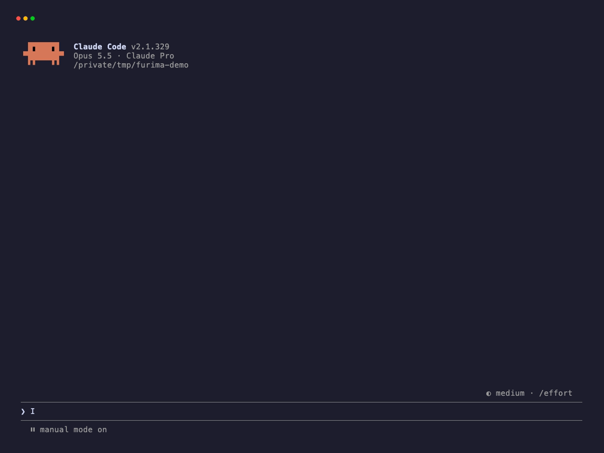
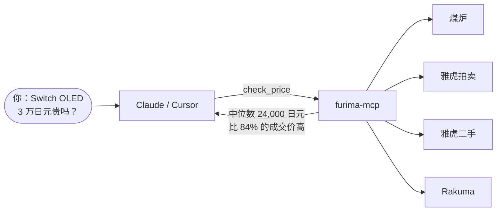

<div align="center">


# furima-mcp

**让 AI 帮你查：这东西在日本二手市场实际卖多少钱。**

煤炉（Mercari） · 雅虎拍卖 · 雅虎二手（Yahoo!フリマ） · 乐天 Rakuma

[](https://github.com/fxia0018/furima-mcp/actions/workflows/ci.yml)
[](https://pypi.org/project/furima-mcp/)
[](https://pypi.org/project/furima-mcp/)
[](LICENSE)

<a href="https://glama.ai/mcp/servers/fxia0018/furima-mcp"></a>

[English](README.md) | [日本語](README.ja.md) | 中文

</div>



furima-mcp 是一个 [MCP](https://modelcontextprotocol.io) 服务器，可以理解成给 Claude、Cursor 这类 AI 应用装的小插件。装上以后，AI 能同时搜日本四大二手网站，并根据**实际成交价**判断一个价格贵不贵。

<table>
<tr>
<td width="50%" valign="top">

### 四个网站一起搜
煤炉、雅虎拍卖、雅虎二手、Rakuma 几秒内一起查完。某个网站挂了，不影响其他网站的结果。

</td>
<td width="50%" valign="top">

### 看成交价，不看挂价
用最近卖出去的价格算中位数、四分位和区间。问"3 万日元贵不贵"，它会告诉你这个价格排在第几百分位。

</td>
</tr>
<tr>
<td valign="top">

### 按成色比
全新、几乎全新、有划痕……四个网站用的是同一套六档成色，行情按成色分开算，不会拿全新未拆的和用旧的混在一起比。

</td>
<td valign="top">

### 蹲新货
"有便宜的上架就告诉我。"每次检查只返回上次之后新上架的商品。

</td>
</tr>
</table>

不需要账号、API key 或浏览器。只读，访问频率很低，不会给网站添负担。

## 工作方式



| 网站 | 在售商品 | 成交价 | 成色 |
| --- | --- | --- | --- |
| 煤炉 | 支持 | 支持 | 支持 |
| 雅虎拍卖 | 支持 | 支持（最终落札价） | 支持 |
| 雅虎二手 | 支持 | 支持（通过雅虎拍卖） | 支持 |
| Rakuma | 支持 | 支持 | 按成色筛选时才有 |

## 上手

**1. 安装 uv。** 它能直接运行 Python 工具，不用自己配环境。装过了可以跳过。

```sh
# macOS / Linux
curl -LsSf https://astral.sh/uv/install.sh | sh

# Windows（PowerShell）
powershell -ExecutionPolicy ByPass -c "irm https://astral.sh/uv/install.ps1 | iex"
```

**2. 加到你的 AI 应用里。** 选你用的那个：

<details open>
<summary><b>Claude Desktop 一键安装</b>（不需要 uv）</summary>

从[最新版本](https://github.com/fxia0018/furima-mcp/releases/latest)下载 `furima-mcp-<版本号>.mcpb`，双击打开，在弹出的窗口里点 **Install**。这样第 1 步可以跳过。

</details>

<details>
<summary><b>Claude Desktop 手动配置</b></summary>

打开 **设置（Settings）→ 开发者（Developer）→ Edit Config**，会打开 `claude_desktop_config.json`。把下面的内容粘进去（文件里已经有 `mcpServers` 的话，加到里面），保存后重启 Claude Desktop：

```json
{
  "mcpServers": {
    "furima": {
      "command": "uvx",
      "args": ["furima-mcp"]
    }
  }
}
```

</details>

<details>
<summary><b>Claude Code</b></summary>

```sh
claude mcp add furima -- uvx furima-mcp
```

</details>

<details>
<summary><b>Cursor 和其他 MCP 应用</b></summary>

把上面 Claude Desktop 的 JSON 写进应用的 MCP 配置里，Cursor 是 `.cursor/mcp.json`。

</details>

<details>
<summary><b>Docker</b>（不需要 Python 和 uv）</summary>

```sh
docker build -t furima-mcp https://github.com/fxia0018/furima-mcp.git
```

然后在上面的 JSON 里改成 `"command": "docker", "args": ["run", "-i", "--rm", "furima-mcp"]`。

</details>

**3. 直接问。** 比如：

- 查一下「ドラクエ3 SFC 箱説付き」的行情
- 二手 Switch OLED 3 万日元贵吗？
- Switch OLED 全新未拆和二手差多少钱？
- 找 5,000 日元以下的「ピカチュウ 25th プロモ」，从便宜到贵，不要 PSA 评级的
- 帮我蹲 12 万日元以下的索尼 α7 III 机身，每次问的时候告诉我有没有新上架的
- 这个划算吗？ https://jp.mercari.com/item/m12345678901

关键词尽量用日文。商品名和型号（`CFI-2000`、`ILCE-7M3`）比中文或英文描述准得多。

## 常见问题

<details>
<summary><b>Claude Desktop 提示服务器启动失败，或者 "spawn uvx ENOENT"</b></summary>

macOS 上的桌面应用有时看不到终端能用的目录，所以找不到 `uvx`。在终端运行 `which uvx`（Windows 用 `where uvx`），把输出的完整路径填进 `"command"`，比如 `"/Users/you/.local/bin/uvx"`，然后重启 Claude Desktop。

</details>

<details>
<summary><b>要账号、API key 或者付费吗？</b></summary>

不用。furima-mcp 免费，只读取任何人用浏览器都能看到的公开页面。AI 应用本身的套餐和用量限制照常适用。

</details>

<details>
<summary><b>它会自己下单或者给卖家发消息吗？</b></summary>

不会。所有工具都是只读的，也从不登录，没法操作任何账号。

</details>

<details>
<summary><b>结果里混进了配件、空盒、坏机</b></summary>

这些网站的关键词搜索比较宽松。搜得具体一点（型号最有用），让 AI 排除「ジャンク」（坏机）、「箱のみ」（只有盒子）这类词，再按成色筛选。查行情的工具默认只用标题里包含全部关键词的商品。

</details>

<details>
<summary><b>价格准吗？</b></summary>

价格就是网站上的原始数字，可能出偏差的是"搜到了哪些商品"，见上一条。煤炉和 Rakuma 大多包邮，雅虎拍卖经常不包邮，所以雅虎的价格看起来会便宜一点。下单前请一定点进商品页确认。

</details>

## 工具

这些是 AI 在后台调用的，你不需要自己调用。

| 工具 | 作用 |
| --- | --- |
| `search_listings` | 搜在售商品。可以按网站、价格、成色筛选，按相关度、最新、价格排序（价格排序跨网站）。 |
| `new_listings` | 上次检查之后新上架的商品，最新的在前。第一次不带游标调用，之后把返回的游标传回去。 |
| `sold_price_stats` | 最近成交价的最低、25%、中位数、75%、最高，分整体、网站、成色，附几条成交实例和成交时间范围。配件、批量打包这类离谱价格默认剔除。 |
| `check_price` | 一个价格在同成色最近成交价里排第几（百分位），加一句结论。 |
| `get_listing` | 单个商品链接的详情：描述、成色、图片、卖家评价、拍卖结束时间。 |

<details>
<summary><b>参数和细节</b></summary>

- **`conditions`**（所有搜索类工具）：四个网站共用的六档成色。`new`（新品、未使用）、`like_new`（未使用に近い）、`good`（目立った傷や汚れなし）、`fair`（やや傷や汚れあり）、`poor`（傷や汚れあり）、`bad`（全体的に状態が悪い）。
- **`exclude`**：标题里包含这些词的商品会被去掉，比如 `["ジャンク", "箱のみ"]`。
- **`match_all_words`**（查行情的工具默认开启）：只用标题里包含全部关键词的商品。在煤炉搜 `PS5 CFI-2000` 会混进 PS5 游戏，中位数会被拉低到游戏的价格。
- **成交记录**：雅虎拍卖的已结束拍卖和 Rakuma 的已售商品按时间从新到旧，煤炉的已售商品按相关度。雅虎二手自己没有成交搜索，它卖出的商品通过雅虎拍卖的成交搜索拿到，标记为 `paypay`。每个网站最多读最近 `sample` 条成交，不是全部历史。
- **成色**：Rakuma 的搜索结果不显示成色，只有指定 `conditions` 时，Rakuma 的商品才带成色（会按每档成色分别搜一次）。
- **拍卖价格**（`is_auction: true`）是当前出价，到 `ends_at` 之前还可能上涨。
- **蹲新货**：每次检查读取每个网站最新的 40 条。两次检查之间上架的比这更多时，`may_have_missed` 里会出现网站名，检查间隔缩短就行。重新上架和降价的旧商品不算新货。
- **煤炉的 `sold_at`** 是商品最后更新时间，一般就是卖出时间。**Mercari Shops** 的商品能搜到，但 `get_listing` 暂不支持。

</details>

<details>
<summary><b>配置</b></summary>

环境变量，都是可选的：

| 变量 | 默认值 | 说明 |
| --- | --- | --- |
| `FURIMA_MIN_INTERVAL` | `1.0` | 对同一个网站两次请求之间的最短间隔（秒）。调大可以，不建议调小。 |
| `FURIMA_CACHE_TTL` | `300` | 相同搜索复用结果的秒数。`0` 表示不缓存。 |

对同一个网站的请求至少间隔 `FURIMA_MIN_INTERVAL` 秒，遇到 `429`/`503` 会等待后重试，相同的搜索直接用缓存。

</details>

## 使用规范

这个工具替提问的人读取浏览器里人人都能看到的公开页面，一次一个搜索，用于个人购物和查行情。

请不要用它大量抓取数据、收集别人的商品信息建数据库，或者自动下单、倒卖。它不带任何账号、Cookie 或个人信息，以后也不会加。如果网站方希望调整什么，请开 issue，会尽快处理。

## 免责声明

furima-mcp 是独立的非官方项目，与 Mercari, Inc.、LY Corporation、乐天集团及其他任何被读取的网站都没有关联，也未获得它们的认可或赞助。商品名称、商标和商品内容归各自的权利人所有。

网站随时可能改版或限制访问，结果可能不完整、有延迟或有错误。价格和结论仅供参考，不构成购买建议，下单前请查看商品页面。遵守各网站的服务条款和当地法律是使用者自己的责任。本软件按现状提供，不附带任何保证，详见 [LICENSE](LICENSE)。

## 许可证

MIT
